# RunwayX

**The financial operating system for startups.**
Know your runway, not just your spend.

Android and iOS · AI CFO built in · Secure cloud · Free to start

---

| [For users](#for-users) | [For developers](#for-developers) |
| --- | --- |
| What RunwayX does, how it works, features, pricing, pitch summary and FAQ. No technical knowledge needed. | Architecture, codebase, local setup, environment variables, contribution workflow and coding standards. |

---

# For users

## Overview

RunwayX tracks every expense a startup makes, shows how many months of money are left, and gives the team an AI CFO that answers questions using the startup's own numbers.

| 10 seconds | 0 | 24/7 | 100% |
| :---: | :---: | :---: | :---: |
| to log an expense | spreadsheets needed | AI CFO availability | of spend visible |

**Contents**

1. [The problem](#the-problem)
2. [What RunwayX answers](#what-runwayx-answers)
3. [Features](#features)
4. [How it works](#how-it-works)
5. [How runway is calculated](#how-runway-is-calculated)
6. [AI CFO](#ai-cfo)
7. [Receipt scanning](#receipt-scanning)
8. [Team and payroll](#team-and-payroll)
9. [Platform overview](#platform-overview)
10. [Data and privacy](#data-and-privacy)
11. [Comparison](#comparison)
12. [Pricing](#pricing)
13. [Pitch summary](#pitch-summary)
14. [FAQ](#faq)
15. [Ask AI about RunwayX](#ask-ai-about-runwayx)

---

## The problem

Most early-stage founders cannot say exactly how long their money will last. Receipts get lost, spreadsheets go stale, and accounting software is built for accountants. By the time the bank balance looks worrying, there is little time left to act.

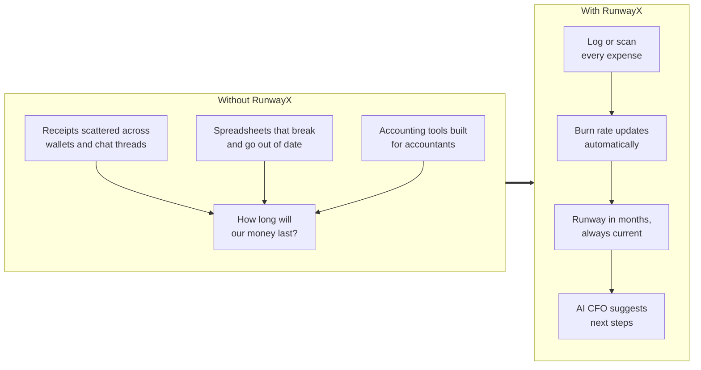

---

## What RunwayX answers

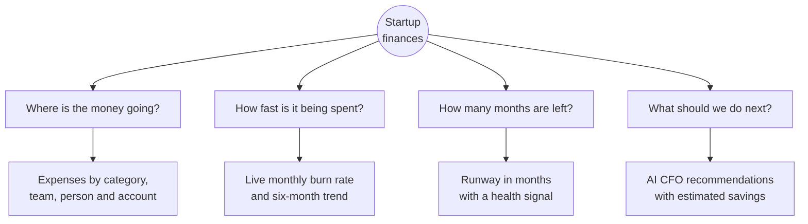

---

## Features

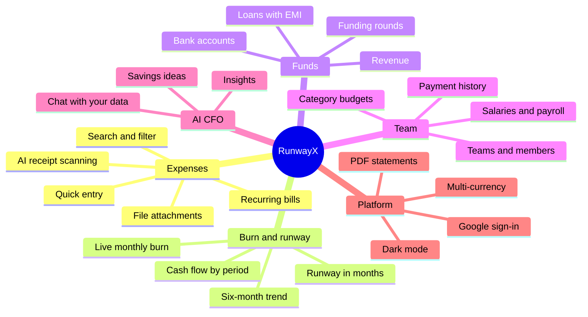

| Feature | Description |
| --- | --- |
| **Expense tracking** | Log each expense with category, note, payment method and receipt. Recurring bills are counted every month automatically. |
| **Receipt scanning** | Photograph a bill and RunwayX fills in the amount, vendor, date and category. |
| **Burn rate** | Monthly spend, updated as soon as an expense is added. |
| **Runway** | The number of months of cash remaining, with a clear health signal. |
| **Funding and loans** | Record funding rounds and loans. Loan EMIs are calculated for you. |
| **Bank accounts** | Spend per bank account and cash. Account numbers show only the last four digits. |
| **Team and payroll** | Teams, members, salaries, payments and full history in one place. |
| **Budgets** | A budget for each category, with a signal when spend goes over. |
| **AI CFO** | Insights and plain-language answers based on real data. |
| **Statements** | PDF statements for investors, banks or accountants. |
| **Multi-currency** | Amounts follow the user's country, including lakh and crore formatting for INR. |
| **Light and dark mode** | Both themes, remembered between sessions. |

---

## How it works

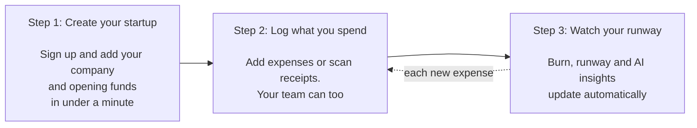

---

## How runway is calculated

RunwayX recalculates every time data changes. The example below uses sample figures.

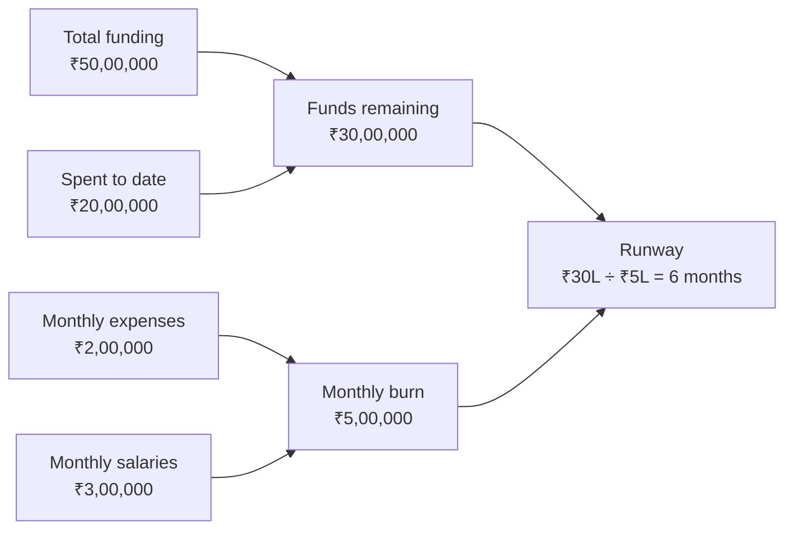

| Metric | Definition |
| --- | --- |
| Funds remaining | Total funding minus everything spent to date |
| Monthly burn | Expenses plus salaries for the month. If the current month has no data, the average of the last three months is used |
| Runway | Funds remaining divided by monthly burn |

---

## AI CFO

Ask about burn, overspending or runway and receive a clear answer based on the startup's own numbers. When there is no data yet, the AI asks for expenses to be added rather than inventing figures.

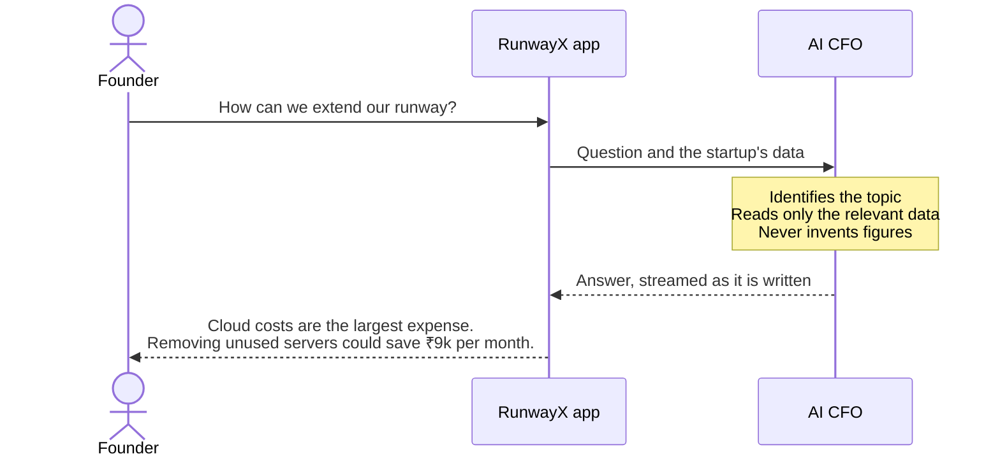

The **AI Insights** screen contains seven cards, refreshed only when the underlying data changes.

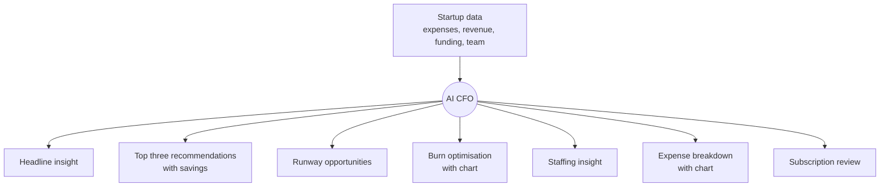

Topics the AI CFO handles:

| Finance | Spending | Team | Growth |
| --- | --- | --- | --- |
| Burn rate | Cost reduction | Payroll | Revenue |
| Runway | Infrastructure | Hiring | Fundraising |
| Cash flow | Subscriptions | Team costs | Marketing |
| Overall health | Monthly spend | Staffing | General strategy |

---

## Receipt scanning


---

## Team and payroll

Co-founders and employees share one ledger. Members log expenses, admins manage budgets, and payroll sits alongside everything else.

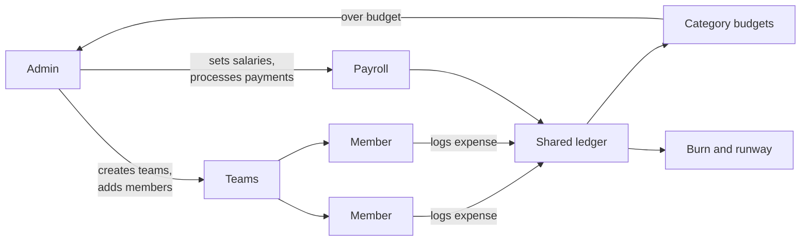

---

## Platform overview

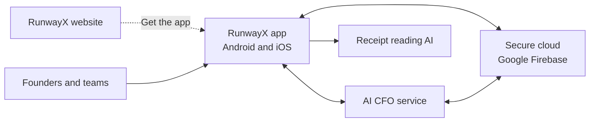

A detailed technical diagram is in the [Architecture](#architecture) section for developers.

---

## Data and privacy

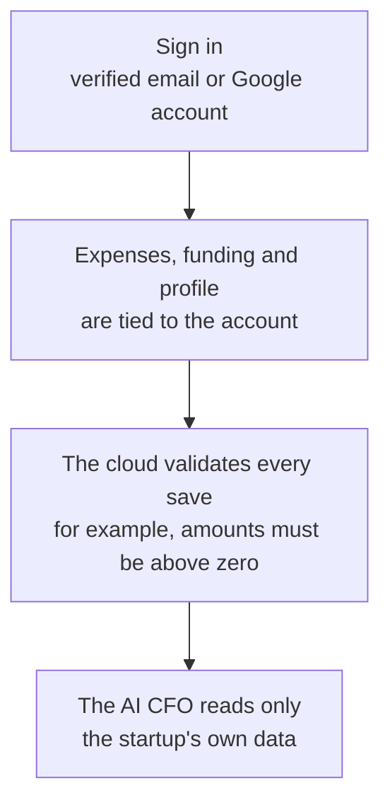

- Data is stored on Google Firebase with access rules for each startup.
- Bank account numbers are masked to the last four digits.
- Only invited members can see a startup's numbers.

---

## Comparison

| | Spreadsheet | Accounting software | RunwayX |
| --- | :---: | :---: | :---: |
| Designed for founders | No | No | **Yes** |
| Runway always current | Manual | Requires setup | **Automatic** |
| AI receipt scanning | No | Sometimes | **Yes** |
| Plain-language questions | No | No | **AI CFO** |
| Team expenses and payroll together | Difficult | Yes | **Yes** |
| Mobile-first | Limited | Limited | **Yes** |
| Time to log an expense | Minutes | Minutes | **About 10 seconds** |

---

## Pricing

| Starter | Team | Scale |
| :---: | :---: | :---: |
| **Free** | **₹999 per month** | **Custom** |
| For solo founders | For small teams | For growing teams |
| 1 startup<br/>Unlimited expenses<br/>Burn and runway | Up to 10 members<br/>Receipt scanning<br/>Category budgets<br/>AI CFO | Unlimited members<br/>Priority support<br/>Custom reports |

---

## Pitch summary

| | |
| --- | --- |
| **Problem** | Founders run out of money because burn and runway are hard to see. Spreadsheets break and accounting tools are not designed for them. |
| **Solution** | A mobile app that tracks every expense, calculates burn and runway in real time, and includes an AI CFO that explains the numbers. |
| **Audience** | Founders and small startup teams without a finance function. |
| **Differentiation** | AI receipt scanning, an AI CFO grounded in real data, and team payroll and budgets in a single mobile app. |
| **Business model** | Freemium: free Starter plan, Team plan at ₹999 per month, custom Scale plan. |
| **Technology** | Flutter for Android and iOS, Google Firebase, a Python AI service and current large language models. |
| **Website** | Next.js landing site with an interactive product demo. |

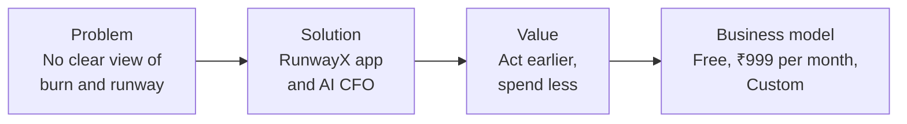

---

## FAQ

**Who is RunwayX for?**
Founders and small startup teams who want clarity on spend, burn and runway without hiring a finance team.

**How is runway calculated?**
Funds remaining divided by monthly burn, using real expenses and salaries. See [How runway is calculated](#how-runway-is-calculated).

**Is financial data secure?**
Data is stored on Google Firebase with per-startup access rules. Only invited members can see a startup's numbers.

**Can team members add expenses?**
Yes. Members log expenses and admins review them.

**Which platforms are supported?**
Android and iOS.

**Does the AI invent numbers?**
No. It works only from the startup's data. With no data, it asks for expenses to be added first.

---

## Ask AI about RunwayX

The website includes an "Ask AI about RunwayX" control in the FAQ and footer. The same prompt is available here:

> RunwayX is a finance app for startups, built with Flutter for Android and iOS. It tracks expenses, calculates burn rate and runway, supports team members with role-based access, scans receipts and includes an AI CFO chat. Data is stored on Firebase with per-startup access rules. Explain what an app like this does and what a founder should check when evaluating it.

- [Ask ChatGPT](https://chatgpt.com/?q=RunwayX%20is%20a%20finance%20app%20for%20startups%2C%20built%20with%20Flutter%20for%20Android%20and%20iOS.%20It%20tracks%20expenses%2C%20calculates%20burn%20rate%20and%20runway%2C%20supports%20team%20members%20with%20role-based%20access%2C%20scans%20receipts%20and%20includes%20an%20AI%20CFO%20chat.%20Data%20is%20stored%20on%20Firebase%20with%20per-startup%20access%20rules.%20Explain%20what%20an%20app%20like%20this%20does%20and%20what%20a%20founder%20should%20check%20when%20evaluating%20it.)
- [Ask Claude](https://claude.ai/new?q=RunwayX%20is%20a%20finance%20app%20for%20startups%2C%20built%20with%20Flutter%20for%20Android%20and%20iOS.%20It%20tracks%20expenses%2C%20calculates%20burn%20rate%20and%20runway%2C%20supports%20team%20members%20with%20role-based%20access%2C%20scans%20receipts%20and%20includes%20an%20AI%20CFO%20chat.%20Data%20is%20stored%20on%20Firebase%20with%20per-startup%20access%20rules.%20Explain%20what%20an%20app%20like%20this%20does%20and%20what%20a%20founder%20should%20check%20when%20evaluating%20it.)
- [Ask Gemini](https://gemini.google.com/app?prompt=RunwayX%20is%20a%20finance%20app%20for%20startups%2C%20built%20with%20Flutter%20for%20Android%20and%20iOS.%20It%20tracks%20expenses%2C%20calculates%20burn%20rate%20and%20runway%2C%20supports%20team%20members%20with%20role-based%20access%2C%20scans%20receipts%20and%20includes%20an%20AI%20CFO%20chat.%20Data%20is%20stored%20on%20Firebase%20with%20per-startup%20access%20rules.%20Explain%20what%20an%20app%20like%20this%20does%20and%20what%20a%20founder%20should%20check%20when%20evaluating%20it.) (paste the prompt if it does not prefill)
- [Ask DeepSeek](https://chat.deepseek.com/) (paste the prompt)

---

# For developers

How RunwayX is built and how to contribute to it.

**Contents**

1. [Repositories](#repositories)
2. [Architecture](#architecture)
3. [Landing website](#landing-website)
4. [Mobile app](#mobile-app)
5. [AI backend](#ai-backend)
6. [Data model and security rules](#data-model-and-security-rules)
7. [Local setup](#local-setup)
8. [Environment variables](#environment-variables)
9. [Contributing](#contributing)
10. [Deployment](#deployment)
11. [Known issues before launch](#known-issues-before-launch)
12. [Star history](#star-history)
13. [Credits](#credits)

---

## Repositories

| Part | Technology | Location | Repository |
| --- | --- | --- | --- |
| Landing website (this repository) | Next.js 16, React 19, Tailwind CSS 4 | `runwayx-landing/` | [sahilmishra03/runwayX-landing-site](https://github.com/sahilmishra03/runwayX-landing-site) |
| Mobile app | Flutter 3.38 (Dart 3.10), Firebase | `runwayx/app/` | [krishgupta-5/SET](https://github.com/krishgupta-5/SET) |
| AI backend | Python, FastAPI, Groq LLM, Firebase Admin | `runwayx/backend/` | Same as the app |

---

## Architecture

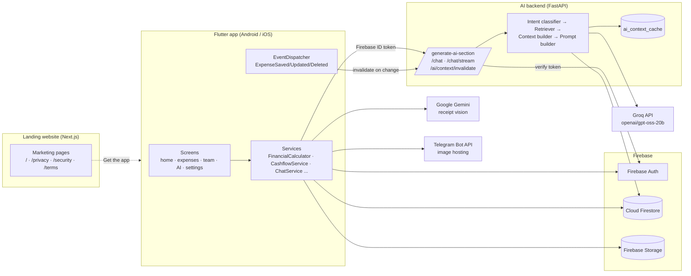

Chat request flow:

1. The app builds a snapshot of the user's financial data on-device and sends it with the question, history and currency symbol to `/chat/stream`, authenticated with a Firebase ID token.
2. The backend verifies the token, classifies the intent with keyword rules, loads or rebuilds a cached business summary, retrieves only the data relevant to that intent, and builds the prompt.
3. Groq streams the answer back as server-sent events.
4. When an expense is saved, updated or deleted, `AiContextManager` calls `/ai/context/invalidate` so the next answer uses current figures.

### Calculations

- **Gross burn** = expenses + salaries. **Net burn** = gross burn − revenue.
- Current-month burn falls back to a three-month rolling average when the month is empty. Recurring expenses are expanded per month.
- **Runway (months)** = (total funding − total spent) ÷ monthly burn.
- Loans support EMI with flat or reducing interest rates.
- Cash flow is available for the current month, last month, last quarter, last six months and last year.

All financial math lives in `FinancialCalculator` (`app/lib/services/financial_calculator.dart`). Do not duplicate calculations in UI code.

---

## Landing website

This repository: a single marketing page plus legal pages.

### Stack

| Area | Choice |
| --- | --- |
| Framework | Next.js 16.4 (App Router, Turbopack, `cacheComponents`, `partialPrefetching`) |
| UI | React 19.3, Tailwind CSS 4 |
| Animation | `motion`, `lenis` smooth scroll |
| Icons | `lucide-react`, `@lobehub/icons-static-svg` |
| Effects | `metal-fx` |
| Fonts | Geist, Geist Mono, Fraunces (`next/font`), Satoshi (local) |
| Language | TypeScript 5, ESLint 9 (`eslint-config-next`) |

### Page structure (`src/app/page.tsx`)

| Section | Component | Content |
| --- | --- | --- |
| Navbar | `Navbar.tsx` | Floating glass navbar that hides on scroll down and returns on scroll up |
| Hero | `Duna.tsx → Hero` | Headline, painting backdrop with a brushed mask edge, "Get the app" CTA |
| Intro | `Sections.tsx → Intro` | Scripted product demo (`Demo.tsx`) with a synced dashboard and phone. Plays only on screen, pausable, respects reduced motion |
| Features | `Sections.tsx → Features` | Six-card feature grid |
| Showcase | `Sections.tsx → Showcase` | Expenses, Burn and runway, Team rows with phone mockups |
| How it works | `Sections.tsx → HowItWorks` | Three onboarding steps |
| AI section | `Duna.tsx → CenterAI` | AI CFO section with a rising phone |
| Stats | `Sections.tsx → Stats` | Four headline figures |
| Pricing | `Sections.tsx → Pricing` | Starter, Team, Scale |
| FAQ | `Sections.tsx → FAQ` | Accordion and the Ask AI card |
| Footer | `Duna.tsx → Footer` | Link columns, app store links, legal bar, Ask AI capsule |

Other routes: `/privacy`, `/security`, `/terms`.

### Components

| File | Purpose |
| --- | --- |
| `src/components/Mockups.tsx` | Phone frame and coded app screens (home, expenses, runway, team, AI, scan) |
| `src/components/Demo.tsx` | Chaptered demo player with KPI tiles and a 12-month burn chart |
| `src/components/AskAI.tsx` | Links to ChatGPT, Claude, Gemini and DeepSeek; copies the prompt to the clipboard |
| `src/components/PixelScene.tsx` | Procedural pixel-art canvas scene |
| `src/components/Reveal.tsx` | Scroll-reveal wrapper |
| `src/components/SmoothScroll.tsx` | Lenis smooth scrolling |
| `src/components/ui/MetalButton.tsx`, `RaiseButton.tsx` | CTA buttons |

### Layout

```
runwayx-landing/
├── public/                 favicons, manifest, logos, paintings, Satoshi font
│   └── images/             hero, footer and section backdrops
├── src/
│   ├── app/
│   │   ├── layout.tsx      fonts, metadata, icons, smooth scroll
│   │   ├── page.tsx        landing page composition
│   │   ├── globals.css
│   │   └── privacy/ security/ terms/
│   └── components/         sections, mockups, demo, Ask AI, buttons
├── brand/                  logo scripts and candidates (git-ignored)
├── next.config.ts
└── package.json
```

### Scripts

```bash
npm install      # install dependencies
npm run dev      # development server at http://localhost:3000
npm run build    # production build
npm run start    # serve the production build
npm run lint     # ESLint
```

### Accessibility

Semantic landmarks, `aria-expanded` and `aria-controls` on the FAQ, `aria-live` clipboard feedback, screen-reader labels on external links, decorative images hidden from assistive technology, and reduced-motion support in the demo. Full WCAG compliance requires manual testing with assistive technologies.

---

## Mobile app

Location: `runwayx/app/` (package `startup_expense_tracker`, display name RunwayX).

### Stack

| Area | Packages |
| --- | --- |
| UI | `shadcn_ui`, `hugeicons`, `google_fonts`, `shimmer`, `flutter_markdown` |
| Charts and dates | `fl_chart`, `table_calendar` |
| Firebase | `firebase_core`, `firebase_auth`, `cloud_firestore`, `firebase_storage`, `google_sign_in` |
| State | `provider`, `ValueNotifier`, custom `EventDispatcher` |
| Media | `camera`, `image_picker`, `image_cropper`, `file_picker`, `permission_handler` |
| Documents | `pdf`, `printing` |
| Networking and config | `http`, `flutter_dotenv`, `shared_preferences`, `url_launcher`, `webview_flutter` |
| Other | `country_code_picker`, `uuid` |

### Layout

```
app/lib/
├── main.dart                 dotenv, Firebase init, AI listeners, theme and currency cache
├── features/
│   ├── auth/                 login, signup, email verification, password reset, Google sign-in
│   ├── company-setup/        onboarding: company, funds, bank accounts
│   ├── home/                 dashboard, burn, runway, funds, bank accounts, chatbot
│   ├── expenses/             add, edit, details, scan, search, report, file viewer
│   ├── team/                 teams, members, salaries, payments, history
│   ├── ai/                   AI insights screen and cards
│   ├── settings/             budgets, categories, funding, recurring, statements, profile
│   └── navigation/           bottom navigation
├── services/                 business logic
├── models/domain_events.dart ExpenseSaved, ExpenseUpdated, ExpenseDeleted
├── theme/                    theme and colours
├── widgets/                  shared UI kit
└── shared/, utils/           error handling and helpers
```

### Services

| Service | Responsibility |
| --- | --- |
| `FinancialCalculator` | All financial math: funds, runway, burn, rolling average, budget variance, EMI |
| `FinancialDataService` | Monthly burn, six-month trend, team costs, budgets vs actual (5-minute cache) |
| `CashflowService` | Cash flow by period, trends, comparisons, top categories |
| `ExpenseService` | Creates and updates expenses, dispatches domain events |
| `BankAccountService` | Bank accounts with stable IDs and spend per account |
| `TeamMemberService` | Teams and members, scheduled salary changes |
| `AIService`, `AiCacheService` | AI section data and local insight cache |
| `AiContextManager` | Invalidates the backend AI context on expense events |
| `ChatService` | Chat requests (standard and streaming) with an on-device data snapshot |
| `ApiService` | Gemini vision calls for receipt extraction, with retry and regex fallback |
| `TelegramService` | Image upload and URL resolution via the Telegram Bot API (6-hour cache) |
| `CurrencyFormatter`, `CurrencyPreferenceService`, `UserCountryService` | Currency symbols, decimals, compact formatting |
| `ThemeService` | Light and dark preference synced with Firestore |

### Tests

`app/test/` contains `currency_symbol_test.dart`, `name_sync_test.dart` and `widget_test.dart`. Run with `flutter test`.

---

## AI backend

Location: `runwayx/backend/`. A FastAPI service that produces insights and chat answers using Groq (`openai/gpt-oss-20b`, JSON mode, low reasoning effort).

### Endpoints

All endpoints except `/` require `Authorization: Bearer <Firebase ID token>`.

| Method | Path | Purpose |
| --- | --- | --- |
| GET | `/` | Health check |
| POST | `/generate-ai-section` | Computes metrics with pandas and returns structured JSON for one insight section |
| POST | `/chat` | Complete chat answer |
| POST | `/chat/stream` | Streaming chat answer (`text/event-stream`) |
| POST | `/ai/context/invalidate` | Clears the cached business context for the user |

- `/generate-ai-section` body: `{ sectionName, sectionData: { expenses, revenue, company, members, teams }, currencySymbol }`. Sections: `main`, `keyPoints`, `runway`, `burn`, `staffing`, `expense`, `subscription`.
- `/chat` body: `{ question, sessionId?, history[], sectionData?, currencySymbol }`.
- Risk level from net burn: Low, Medium above 50,000, High above 100,000.

### Services

| File | Role |
| --- | --- |
| `auth_service.py` | Firebase Admin initialisation and ID token verification (10-second timeout) |
| `intent_classifier.py` | Keyword rules mapping a question to an intent |
| `retriever_service.py` | Selects the data relevant to the intent |
| `context_builder.py` | Builds a readable business summary |
| `prompt_builder.py` | Assembles system prompt, summary, context and history |
| `chat_service.py` | Groq calls (standard and streaming) with latency logging |
| `cache_service.py` | Per-user context cache in Firestore `ai_context_cache` (1-hour TTL, in-memory fallback) |
| `firestore_service.py` | Firestore reads with timeouts |
| `logger.py` | Structured chat and cache logs |

Dependencies: `fastapi`, `uvicorn`, `requests`, `python-dotenv`, `pandas`, `firebase-admin`.

---

## Data model and security rules

Rules are defined in `runwayx/firestore.rules`.

| Collection | Access |
| --- | --- |
| `users/{userId}` | Owner only; `companyId` cannot change once set |
| `companies/{companyId}` | Create, update and delete by owner |
| `expenses/{expenseId}` | Owner only; `Amount` must be a number above 0, `Title` 1 to 50 characters |
| `funding/{fundingId}` | Owner only |
| `teams/{teamId}`, `members/{memberId}` | Create, update and delete by owner |
| `rate_limits`, `account_security`, `auth_logs` | Any signed-in user |
| All other paths | Denied |

Every rule also requires a verified email or Google sign-in. Firebase project: `startup-expense-tracker-3df6b` (Firestore region `nam5`).

---

## Local setup

### Prerequisites

- Node.js 20+ and npm (website)
- Flutter 3.38.9 (pinned in `app/.fvmrc`) with Android Studio or Xcode (app)
- Python 3.10+ (backend)
- A Firebase project, a Groq API key and a Gemini API key

### Landing website

```bash
git clone https://github.com/sahilmishra03/runwayX-landing-site.git runwayx-landing
cd runwayx-landing
npm install
npm run dev
```

### AI backend

```bash
git clone https://github.com/krishgupta-5/SET.git runwayx
cd runwayx/backend
python -m venv .venv
# Windows: .venv\Scripts\activate   macOS/Linux: source .venv/bin/activate
pip install -r requirements.txt
uvicorn main:app --reload --port 8000
```

### Mobile app

```bash
cd runwayx/app
flutter pub get
flutter run
```

Set `PROD_API_URL` to the local backend (`http://10.0.2.2:8000` on the Android emulator). Firebase configuration lives in `android/app/google-services.json`, `ios/GoogleService-Info.plist` and `lib/firebase_options.dart`; regenerate with `flutterfire configure` for another project.

---

## Environment variables

Do not commit real values. The env files and the Firebase Admin key are git-ignored.

**`runwayx/app/.env.local`**

| Key | Purpose |
| --- | --- |
| `PROD_API_URL` | Backend base URL |
| `GEMINI_API_KEY` | Receipt scanning |
| `TELEGRAM_BOT_TOKEN` | Image uploads |

**`runwayx/backend/.env`**

| Key | Purpose |
| --- | --- |
| `GROQ_API_KEY` | LLM calls for insights and chat |
| `FIREBASE_CREDENTIALS_JSON` | Service account JSON as a string |
| `GOOGLE_APPLICATION_CREDENTIALS` | Path to a service account file |
| `DEBUG_MODE` | Enables the development auth fallback. Set to `false` in production |

The landing website needs no environment variables.

---

## Contributing

Contributions are welcome to the website, the app and the backend.

### Workflow

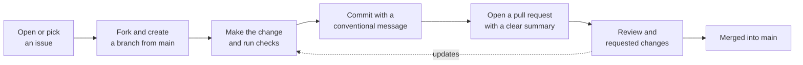

1. **Open an issue first** for anything larger than a small fix, so the approach can be agreed before work starts.
2. **Fork the repository** and create a branch from `main`. Use a descriptive name such as `feature/category-budgets`, `fix/runway-rounding` or `docs/readme-setup`.
3. **Keep changes focused.** One feature or fix per pull request.
4. **Run the checks** for the part you changed (see below).
5. **Open a pull request** against `main` with a short summary, what was tested, and screenshots for UI changes.

### Commit messages

The repositories use [Conventional Commits](https://www.conventionalcommits.org/):

```
feat(ui): add RaiseButton component with raised shadow styling
fix(ai): stop truncated LLM output
chore: ignore local .kiro folder
docs: expand local setup steps
```

Common types: `feat`, `fix`, `docs`, `refactor`, `style`, `test`, `chore`.

### Checks before a pull request

| Area | Commands |
| --- | --- |
| Landing website | `npm run lint` and `npm run build` |
| Mobile app | `flutter analyze` and `flutter test` |
| AI backend | Start with `uvicorn main:app --reload` and confirm `GET /` returns `{"status": "AI backend running"}` |

### Coding standards

- **Website:** TypeScript, function components, Tailwind utility classes. Match the existing typography and spacing. Keep components accessible: labels on interactive elements, `aria-hidden` on decorative images, and respect `prefers-reduced-motion`.
- **App:** keep business logic in `services/` and financial math in `FinancialCalculator`. Use the shared widgets in `widgets/` instead of one-off UI. Dispatch domain events when financial data changes so the AI context stays current.
- **Backend:** never return raw upstream error bodies to clients. Keep prompts grounded in provided data only.
- **Secrets:** never commit API keys, `.env` files or service account JSON.

### Good areas to contribute

- Resolving the items in [Known issues before launch](#known-issues-before-launch)
- Unit tests for `FinancialCalculator` and `CashflowService`
- Backend tests for the intent classifier and endpoints
- Real app screenshots for the website and this README
- Accessibility improvements on the website

---

## Deployment

| Component | Approach |
| --- | --- |
| Website | Any Next.js host such as Vercel: `npm run build`, then `npm run start` |
| Backend | Render: `uvicorn main:app --host 0.0.0.0 --port $PORT`, credentials via `FIREBASE_CREDENTIALS_JSON` or `/etc/secrets/firebase-adminsdk.json` |
| Firestore rules | `firebase deploy --only firestore:rules` from `runwayx/` |
| App | `flutter build appbundle` for Android, `flutter build ipa` for iOS |

---

## Known issues before launch

- `DEBUG_MODE` defaults to `true` in `auth_service.py`. In that mode, requests without a token are treated as `dev-user-id`, and a failed Firebase check falls back to decoding the token without verifying its signature.
- CORS allows all origins with credentials. Restrict it to known origins.
- `.env.local` is bundled as a Flutter asset, so `GEMINI_API_KEY` and `TELEGRAM_BOT_TOKEN` ship inside the app binary. Move those calls behind the backend.
- `companies`, `teams` and `members` are readable by any verified user, and `rate_limits`, `account_security` and `auth_logs` are readable and writable by any signed-in user. Scope access to the owner or company.
- Avatars and images are stored in a Telegram chat. Confirm this matches the privacy policy.

Please report security problems privately to the maintainers rather than in a public issue.

---

## Star history

The chart below updates automatically from GitHub.

[](https://star-history.com/#sahilmishra03/runwayX-landing-site&krishgupta-5/SET&Date)

If RunwayX is useful to you, starring the repositories helps others find it.

---

## Credits

- Public-domain paintings via Wikimedia Commons: Albert Bierstadt, "The Rocky Mountains, Lander's Peak", "Mount Corcoran", "Looking Down Yosemite Valley" (1865) and "Among the Sierra Nevada" (1868); Frederic Edwin Church, "Twilight in the Wilderness" (1860); Thomas Cole, "The Oxbow" (1836); John Constable, "Cloud Study" (1822).
- AI brand logos from `@lobehub/icons-static-svg` (MIT).
- Geist font (SIL Open Font License).

© RunwayX 2026. No license file is included; all rights reserved unless stated otherwise by the owners.
